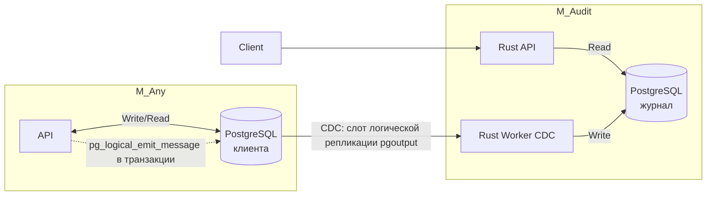

# Waltrail — журнал аудита изменений PostgreSQL

## Локальная разработка

```bash
cp env.example .env
docker compose up -d
```

Compose поднимает минимальный стек:

| Сервис | Роль | Порт на хосте |
| ------ | ---- | ------------- |
| `db1` | БД аудита Waltrail (таблица `changes` + чекпоинты) | `54399` |
| `db-src` | Источник CDC — имитация БД клиента (`wal_level=logical`, публикация `audit` создаётся автоматически) | `54398` |
| `api` | REST API журнала | `8000` |
| `worker-cdc` | Консюмер логической репликации: слот источника → таблица `changes` | — |

Единственный тракт инжеста — слот логической репликации (ADR-0001): воркер `worker-cdc` читает pgoutput-поток источника и пишет журнал в таблицу `changes`. API читает журнал только из `changes`: `GET /api/changes` (список с пагинацией, сортировкой и фильтрами — `trace_id`, таблица, операция, время, вхождение в `context`) и `GET /api/changes/{id}` (детальная); Swagger — на `/swagger-ui`.

Реестр источников (ADR-0005) управляется через REST: `POST /api/sources` (регистрация), `GET /api/sources` (список со статусами воркеров), `GET /api/sources/{name}`, `PATCH /api/sources/{name}` (только служебные таблицы, префикс MESSAGE и размер батча — URL неизменяем), `DELETE /api/sources/{name}` (помечает к удалению, `202`; слот и публикацию у клиента дропает воркер).

Сквозной сценарий «эмит → журнал → REST-фильтр по trace_id»:

```bash
# Демо-таблица на источнике (публикация FOR ALL TABLES подхватит её сама)
docker compose exec db-src psql -U postgres -c \
  "CREATE TABLE IF NOT EXISTS demo (id int PRIMARY KEY, note text)"

# Изменение + контекст операции: pg_logical_emit_message в той же транзакции (ADR-0004).
# MESSAGE строк журнала не создаёт — обогащает context и trace_id строк своей транзакции.
docker compose exec db-src psql -U postgres -c \
  "BEGIN; INSERT INTO demo VALUES (1, 'демо'); \
   SELECT pg_logical_emit_message(true, '_audit', \
   '{\"trace_id\":\"demo-1\",\"user\":\"alice\"}'); COMMIT;"

# Журнал: фильтр по trace_id возвращает строку INSERT с контекстом MESSAGE
curl 'http://localhost:8000/api/changes?trace_id=demo-1'
```

Воркер сам создаёт слот репликации и применяет миграции, после остановки (Ctrl+C/SIGTERM) возобновляет с чекпоинта. Настройки — переменными окружения: `CDC_SLOT`, `CDC_PUBLICATION`, `CDC_MESSAGE_PREFIX` (префикс MESSAGE-канала контекста, ADR-0004), `CDC_IGNORE_TABLES`, `CDC_BATCH_SIZE` (значения по умолчанию — в [`env.example`](env.example)).

> Слот удерживает WAL источника: если воркер на dev-стенде больше не нужен, удалите слот, чтобы WAL не копился:
>
> ```SQL
> SELECT pg_drop_replication_slot('waltrail');
> ```

Подготовка источника для dev: публикация создаётся init-скриптом [`docker/init-source/01_публикация_аудита.sql`](docker/init-source/01_публикация_аудита.sql) при первом создании volume. Слот репликации создаётся воркером CDC автоматически при старте.

### PoC-бенчмарк пропускной способности

Генератор потока (200+ тыс. событий/сек узкими строками) и монитор стенда — в [`scripts/loadgen/`](scripts/loadgen); сводки по трём ступеням конвейера (walsender → intake → вставка) воркер пишет в лог каждые 10 с (цель `worker_cdc::metrics`):

```bash
python3 -m venv .venv && .venv/bin/pip install -r scripts/loadgen/requirements.txt
.venv/bin/python scripts/loadgen/generate.py --duration 60 --sessions 3 --rows-per-tx 10000 --payload-bytes 100
.venv/bin/python scripts/loadgen/monitor.py --duration 120 > monitor.csv
```

Методика, числа и вердикт гейта — в [`docs/benchmarks/0007-poc-пропускная-способность.md`](docs/benchmarks/0007-poc-пропускная-способность.md) (вердикт продублирован в [ADR-0003](docs/adr/0003-гейт-производительности-no-go-вставка-в-changes.md)).

**Внимание:** история миграций переписана под целевую схему журнала без мёртвых объектов (issue #11), а данные сервисов живут в именованных volumes. Если у вас остался старый volume — пересоздайте его:

```bash
docker compose down -v && docker compose up -d
```

> `down -v` удаляет локальные данные dev-стенда (в том числе volume БД аудита).

## Подключение клиента (PostgreSQL)

1. Включите логический WAL и перезапустите базу:
```SQL
    ALTER SYSTEM SET wal_level = logical;
```

__Обязательно нужно перезагрузить postgres!!!__

2. Создайте публикацию и полную репликационную идентичность таблиц:
```SQL
-- Публикация "audit" для всех таблиц
CREATE PUBLICATION audit FOR ALL TABLES;

-- Или только для выбранных таблиц
CREATE PUBLICATION audit FOR TABLE [table1], [table2];

-- Полная репликационная идентичность: в журнал попадают образы "до" (UPDATE/DELETE)
ALTER TABLE [table1] REPLICA IDENTITY FULL;
ALTER TABLE [table2] REPLICA IDENTITY FULL;

-- Чтобы включить отслеживание изменений данных для новой таблицы:
ALTER PUBLICATION audit ADD TABLE [table3];
ALTER TABLE [table3] REPLICA IDENTITY FULL;

-- Чтобы остановить отслеживание изменений данных для таблицы:
ALTER PUBLICATION audit DROP TABLE [table3];
ALTER TABLE [table3] REPLICA IDENTITY DEFAULT;
```

3. Контекст операции передаётся через `pg_logical_emit_message` в собственной транзакции клиента (ADR-0004): ключ `trace_id` верхнего уровня payload становится колонкой журнала, а весь payload — контекстом всех изменений этой транзакции. MESSAGE строк журнала не создаёт: единственное содержимое журнала — изменения строк, событие без изменений строк в него не попадает (журнал событий приложение ведёт само):

```SQL
BEGIN;
UPDATE orders SET status = 'paid' WHERE id = 42;
SELECT pg_logical_emit_message(
    true,
    '_audit',
    '{"trace_id":"op-123","user":"alice","app":"my-app"}'
);
COMMIT;
```


